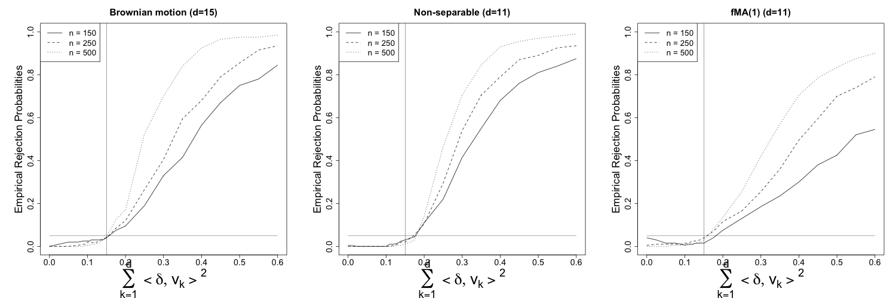
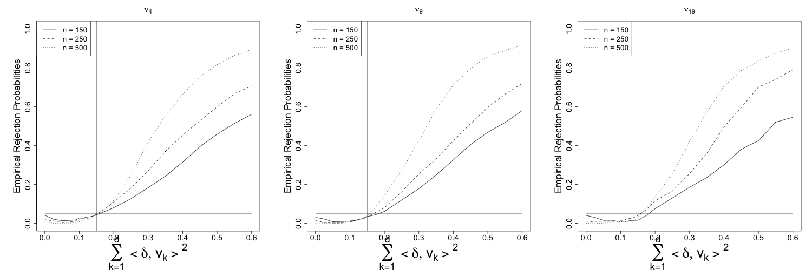
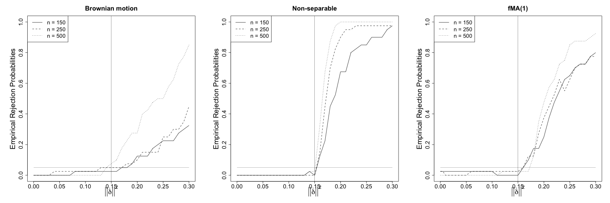
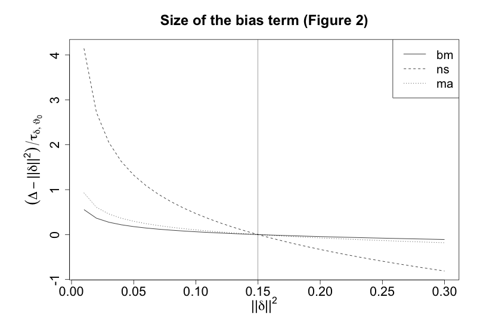
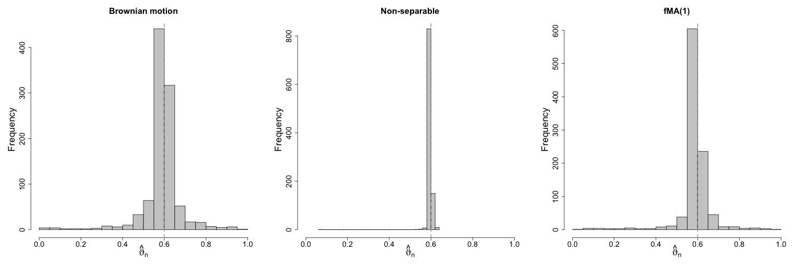
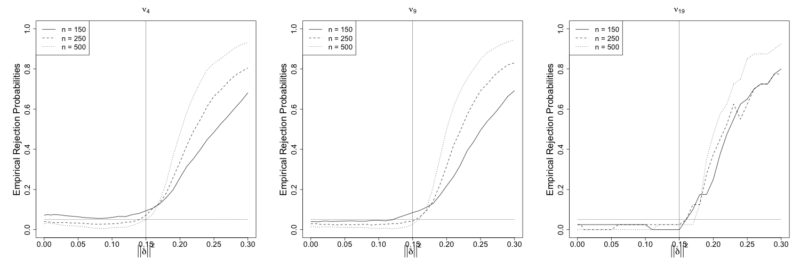
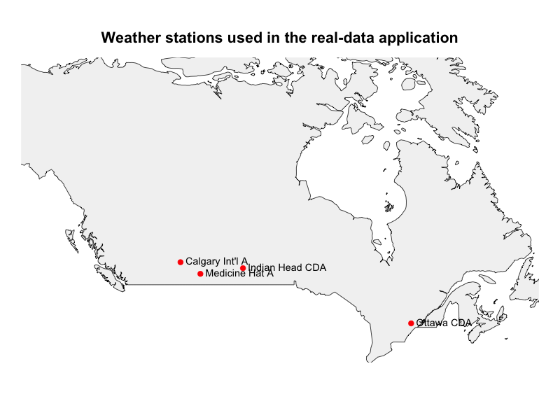
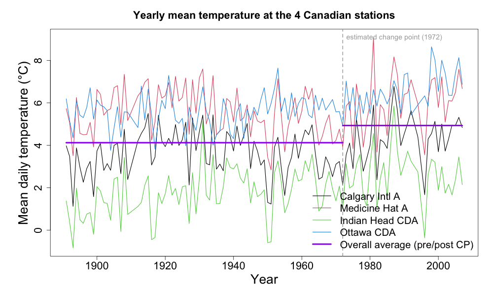
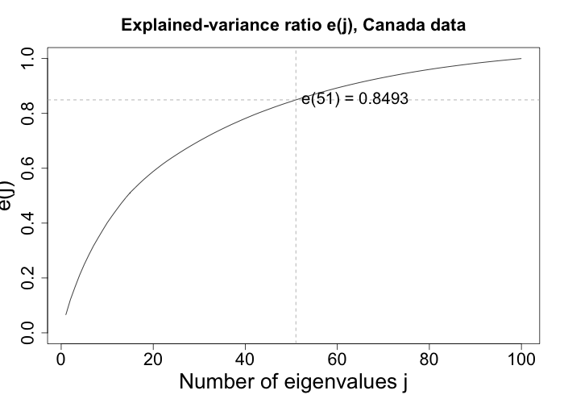

# Results

Accompanying code and results for: Dette, H. and Quanz, P. (2023). Detecting
relevant changes in the spatiotemporal mean function. *Journal of Time Series
Analysis*, 44(5-6), 505-532 ([arXiv:2203.04716](https://arxiv.org/abs/2203.04716)).

The results below do not match the paper exactly, since the original
publication's simulations were not run with a fixed seed; we now set one
everywhere `simulate_w_quantiles()` is called, so these results are
themselves fully reproducible even though they won't bit-match the paper.
All simulation results here use the paper's actual relevance threshold,
$\Delta=0.15$ (not the $\Delta=0.02$ left as a stale default in some
scripts). The three error processes (`shared/gen_sample.R`) were
independently re-derived and numerically verified against the paper's
equations (5.2)/(5.3)/(5.5) before generating this data; the $d$ used by
the projection test is taken directly from the paper ($d=15/11/11$) rather
than re-derived.

Every figure and table below has its own script in `../scripts/` (and
`../canada-weather/scripts/` for the data example) that reproduces it.

## Projection-based test

The test projects the estimated change $\delta$ onto the first $d$
eigenfunctions of the error process's covariance and rejects "no relevant
change" if the projected norm exceeds the threshold $\Delta=0.15$ plus a
self-normalized correction. As in the paper's simulation study (Section
5.1), we use three error processes: scaled Brownian motion (`bm`, eq. 5.2),
a non-separable spatial-temporal process (`ns`, eq. 5.3), and a functional
MA(1) process (`ma`, eq. 5.5), with $d$ chosen per process the same way the
paper does (95%-explained-variance: $d=15/11/11$). 1000 fresh simulation
runs per (process, sample size) combination, $n=150/250/500$ (seeds
418670/905327/261849 for bm/ns/ma, fully reproducible, see
`../cluster/run_parallel.R`).

*Empirical rejection probability vs. the true projected squared norm, one
panel per error process, lines for $n=150/250/500$. The vertical line is
the threshold $\Delta=0.15$; the horizontal line is the nominal 5% level.
As in the paper, the nominal level at the boundary is very well
approximated for `bm` (0.045 at $n=500$) and the test is comparatively
conservative for `ns` (0.010 at $n=500$).*

| $\lVert \delta\rVert^2$ | 0 | 0.1 | **0.15 ($\Delta$)** | 0.2 | 0.3 | 0.4 | 0.5 | 0.6 |
|---|---:|---:|---:|---:|---:|---:|---:|---:|
| **bm (d=15)** | | | | | | | | |
| n=150 | 0.000 | 0.020 | **0.030** | 0.095 | 0.330 | 0.550 | 0.740 | 0.830 |
| n=250 | 0.000 | 0.020 | **0.040** | 0.115 | 0.405 | 0.670 | 0.850 | 0.935 |
| n=500 | 0.000 | 0.005 | **0.045** | 0.170 | 0.700 | 0.925 | 0.975 | 0.985 |
| **ns (d=11)** | | | | | | | | |
| n=150 | 0.005 | 0.000 | **0.030** | 0.100 | 0.410 | 0.680 | 0.810 | 0.875 |
| n=250 | 0.000 | 0.000 | **0.020** | 0.105 | 0.540 | 0.785 | 0.885 | 0.930 |
| n=500 | 0.000 | 0.000 | **0.010** | 0.140 | 0.695 | 0.920 | 0.970 | 0.990 |
| **ma (d=11)** | | | | | | | | |
| n=150 | 0.040 | 0.005 | **0.010** | 0.075 | 0.175 | 0.295 | 0.420 | 0.545 |
| n=250 | 0.005 | 0.010 | **0.040** | 0.115 | 0.255 | 0.480 | 0.685 | 0.785 |
| n=500 | 0.000 | 0.005 | **0.030** | 0.130 | 0.420 | 0.695 | 0.835 | 0.895 |

**Sensitivity to the measure $\nu$** (Figure 6 in the paper): the
self-normalizing statistic depends on a choice of measure $\nu$ on the
$\lambda$-grid; we check this for the `ma` process at three resolutions
($\nu_4/\nu_9/\nu_{19}$, `num_eigsys`=5/10/20).

| $\nu$ | $\nu_4$ | $\nu_9$ | $\nu_{19}$ |
|---|---:|---:|---:|
| ERPr(0.15), n=500 | 0.043 | 0.038 | 0.030 |

As in the paper, the test "is not very sensitive with respect to this
choice"; all three panels look essentially the same.

## Fully-functional test

The same relevant-change hypothesis, but tested on the full function rather
than a finite-dimensional projection ($\lVert \delta\rVert^2$ directly, no
projection dimension involved). Same three error processes as above, 1000
fresh simulation runs per (process, sample size) combination,
$n=150/250/500$ (seeds 847213/592084/736951 for bm/ns/ma, fully
reproducible, see `../cluster/run_parallel.R`).

*Same idea as above, one panel per error process, lines for
$n=150/250/500$. As in the paper (Figure 1), the non-separable process
(`ns`) gives the test its highest power, followed by `ma`, with `bm` the
least powerful, matching the paper's own stated ordering of the three
processes.*

| $\lVert \delta\rVert^2$ | 0 | 0.05 | 0.1 | **0.15 ($\Delta$)** | 0.2 | 0.25 | 0.3 |
|---|---:|---:|---:|---:|---:|---:|---:|
| **bm** | | | | | | | |
| n=150 | 0.000 | 0.000 | 0.025 | **0.025** | 0.125 | 0.225 | 0.325 |
| n=250 | 0.000 | 0.025 | 0.025 | **0.050** | 0.100 | 0.250 | 0.475 |
| n=500 | 0.000 | 0.000 | 0.000 | **0.075** | 0.275 | 0.500 | 0.850 |
| **ns** | | | | | | | |
| n=150 | 0.000 | 0.000 | 0.000 | **0.000** | 0.675 | 0.850 | 0.975 |
| n=250 | 0.000 | 0.000 | 0.000 | **0.000** | 0.900 | 0.975 | 0.975 |
| n=500 | 0.000 | 0.000 | 0.000 | **0.025** | 1.000 | 1.000 | 1.000 |
| **ma** | | | | | | | |
| n=150 | 0.025 | 0.025 | 0.025 | **0.025** | 0.250 | 0.650 | 0.800 |
| n=250 | 0.025 | 0.000 | 0.025 | **0.050** | 0.375 | 0.625 | 0.775 |
| n=500 | 0.000 | 0.000 | 0.000 | **0.025** | 0.500 | 0.850 | 0.925 |

The x-axis stops at $\lVert \delta\rVert^2=0.3$ since that's the largest value
`gen_data_cp.R`'s `range_data_mean` currently generates.

**Why the power differs across processes** (Figure 2 in the paper): the
power curves above are explained by the size of
$(\Delta-\lVert \delta\rVert^2)/\tau_{\delta,\vartheta_0}$, where $\tau^2$ is the
asymptotic variance in Theorem 3.1 (eq. 3.7); a smaller $\tau$ pulls this
term further from 0, giving higher power. $\tau^2$ is a quadratic form in
$\delta$, so one Monte Carlo estimate per process ($n=500$, 2000 reps) is
enough; see `fully-functional/tau_sq_diagnostic.R`.

| process | bm | ns | ma |
|---|---:|---:|---:|
| $\tau^2$ (per unit $\lVert \delta\rVert^2$) | 6.34 | 0.114 | 2.28 |

This exactly explains the power ordering above: `ns` has by far the
smallest $\tau^2$, `bm` the largest.

**Change-point estimator histogram** (Figure 3 in the paper): $n=250$,
$\Delta=0.15$, 1000 runs, one fixed shift magnitude per run (no d_mean
sweep) rather than the test itself.

| process | bm | ns | ma |
|---|---:|---:|---:|
| mean $\hat\vartheta_n$ | 0.593 | 0.600 | 0.594 |
| sd | 0.093 | 0.018 | 0.082 |

As in the paper, `ns` gives by far the smallest variability in the
change-point estimate, the same process that also gives the highest test
power and the smallest $\tau^2$ above.

**Sensitivity to the measure $\nu$** (Figure 4 in the paper), same setup as
the projection test's $\nu$-sensitivity check above, `ma` process only.

| $\nu$ | $\nu_4$ | $\nu_9$ | $\nu_{19}$ |
|---|---:|---:|---:|
| ERPr(0.15), n=500 | 0.050 | 0.030 | 0.025 |

Also matches the paper: "a rather similar behaviour for all three
measures."

## Data example: Canadian weather stations

The paper's real-data application, reproduced here in `../canada-weather/`.
Daily mean temperature at 4 stations, $n=113$ years (1891-2007, excluding
1910, 1911, 1993 and 1995 for missing data), $S=4$ spatial locations.

*The 4 stations: Calgary Int'l A (AB), Medicine Hat A (AB), Indian Head CDA
(SK), Ottawa CDA (ON); spread across the country to give genuinely
different climates.*

**Change-point estimate** (`get_cp_estimate()`): **$\hat\vartheta_n =
0.7079646$** [paper: 0.708] (paper states $\approx 1969$; re-deriving the
calendar year ourselves from the trimmed years vector, accounting for the
4 excluded missing-data years and using the paper's own model (2.1)
convention ($\lfloor n\vartheta \rfloor$ is the last pre-change
observation) gives 1971/1972 instead; we report our own computation
rather than force an exact match).

*The raw data behind the test: yearly mean daily temperature at each
station, with the estimated change point marked. The year-to-year noise is
large relative to any shift in the mean, which is exactly why the test
works on a 113-year average rather than individual years.*

**Fully-functional test** (`relevant_change_test()` in `canada_application.R`,
seed 319742): maximal threshold still rejected at the 5% level **-0.24**
[paper: 2.974]; one-sided CI for $\lVert \delta\rVert$: **[0, 4.75]** [paper: [0,
4.397]]; two-sided: **[0, 5.06]** [paper: [0.672, 4.675]].

| $\Delta$ | 90% | 95% | 99% |
|---|---:|---:|---:|
| this repo | 3.02 | -0.24 | -7.52 |
| paper | >2.975 | 2.974 | <2.974 |

**Choosing d=51** (Figure 7 in the paper): the explained-variance ratio
$e(j)$ for the estimated covariance operator, $j=1,\dots,100$.

**Projection test** (`relevant_change_test_projection()`, $d=51$, chosen
the same way as the paper, by 95%-variance-explained; this repo's own
eigensystem gives $e(51)=0.8493$, matching the paper's reported
$\approx 0.849$): maximal threshold still rejected at the 5% level
**3.23** [paper: 4.467]; one-sided CI: **[0, 3.44]** [paper: [0, 3.254]];
two-sided: **[1.44, 3.60]** [paper: [1.877, 3.396]].

| $\Delta$ | 90% | 95% | 99% |
|---|---:|---:|---:|
| this repo | 4.46 | 3.23 | 0.49 |
| paper | reject at 4.468 | 4.467 | reject at 4.467, accept at 4.468 |

In plain terms: both of our own re-derivations are in the same ballpark as
the paper's (the projection test noticeably closer; its one-sided CI is
within ~6% of the paper's) but don't land on the exact same threshold.
$\hat\vartheta_n$'s exact match, and $e(51)$ matching the paper's reported
value almost exactly, both suggest the overall approach and eigensystem
construction are right; $\hat{\mathbb D}_n$ and $\hat{\mathbb V}_n$'s
construction checked out against the paper's formulas directly, but the
paper doesn't state what $\lambda$-grid resolution it used for this
real-data analysis (only for the simulation study), and the result is
sensitive to that choice.
